<p align="center">
  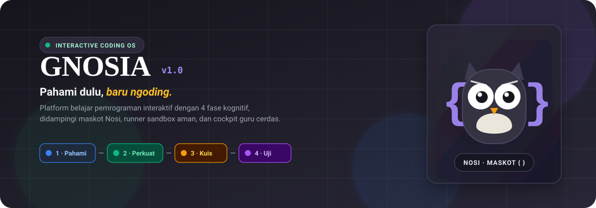
</p>

<p align="center">
  <strong>Platform Pembelajaran Pemrograman Web &amp; JavaScript Interaktif Berbasis Siklus Kognitif 4 Fase</strong>
</p>

<p align="center">
  <a href="#-filosofi--cara-belajar"></a>
  <a href="#-maskot-kami-nosi-"></a>
  <a href="#-arsitektur--teknologi"></a>
  <a href="#-arsitektur--teknologi"></a>
  <a href="#-arsitektur--teknologi"></a>
  <a href="#-menjalankan-aplikasi"></a>
  <a href="LICENSE"></a>
</p>

---

## 📖 Daftar Isi

- [✨ Filosofi: Pahami Dulu, Baru Ngoding](#-filosofi-pahami-dulu-baru-ngoding)
- [🦉 Maskot Kami: Nosi `{ }`](#-maskot-kami-nosi-)
- [🔄 Siklus Belajar 4 Fase (The 4-Phase Loop)](#-siklus-belajar-4-fase-the-4-phase-loop)
- [📸 Galeri Antarmuka](#-galeri-antarmuka)
  - [1. Peta Petualangan Belajar](#1-peta-petualangan-belajar)
  - [2. Fase Pahami & Perkuat](#2-fase-pahami--perkuat)
  - [3. Fase Kuis & Tantangan Ngoding](#3-fase-kuis--tantangan-ngoding)
  - [4. Cockpit Guru & Mentor](#4-cockpit-guru--mentor)
  - [5. Cockpit Admin & Kurikulum Builder](#5-cockpit-admin--kurikulum-builder)
  - [6. Playground Bebas](#6-playground-bebas)
- [🎨 Sistem Desain: Warm Paper & Editorial Ink](#-sistem-desain-warm-paper--editorial-ink)
- [⚙️ Arsitektur & Teknologi](#️-arsitektur--teknologi)
- [🚀 Menjalankan Aplikasi](#-menjalankan-aplikasi)
  - [Opsi A: Docker + Cloudflare Tunnel (Satu Perintah, Otomatis)](#opsi-a-docker--cloudflare-tunnel-satu-perintah-otomatis)
  - [Opsi B: Development Lokal (FastAPI + Vite)](#opsi-b-development-lokal-fastapi--vite)
  - [Opsi C: Deploy Publik di Render](#opsi-c-deploy-publik-di-render-gratis-link-tetap)
- [👥 Akun Demo Siap Pakai](#-akun-demo-siap-pakai)
- [🧪 Menjalankan Pengujian (Testing)](#-menjalankan-pengujian-testing)
- [📁 Struktur Repositori](#-struktur-repositori)
- [📄 Lisensi](#-lisensi)

---

## ✨ Filosofi: Pahami Dulu, Baru Ngoding

Banyak pemula gagal belajar pemrograman karena langsung dipaksa menghafal sintaks dan mengetik kode tanpa memiliki **model mental yang utuh** tentang apa yang sebenarnya terjadi di balik layar.

**GNOSIA** (dari bahasa Yunani *gnosis* yang berarti pengetahuan sejati) mengubah paradigma ini:
1. **Visual First**: Konsep abstrak (variabel, percabangan, fungsi, array) divisualisasikan dengan diagram hidup dan interaksi nyata.
2. **Scaffolded Learning**: Siswa tidak dilempar langsung ke editor kosong; tantangan dibangun lapis demi lapis.
3. **Safe Sandbox**: Kode dieksekusi di lingkungan isolasi Node.js aman dengan evaluasi instan.
4. **Teacher Cockpit**: Guru dan mentor dapat memantau secara real-time kapan siswa tersendat atau memerlukan pendampingan.

---

## 🦉 Maskot Kami: Nosi `{ }`

<p align="center">
  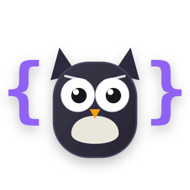
</p>

Perkenalkan **Nosi** — burung hantu cerdas sahabat setia siswa di GNOSIA.

- **Sayap dari Kurung Kurawal (`{ }`)**: Identitas khas dunia kode yang menjadi sayap pelindung Nosi.
- **Ekspresi Reaktif**: Nosi bereaksi terhadap setiap langkah siswa:
  - 🧐 `think`: Saat siswa sedang membaca materi atau memikirkan logika.
  - 🥳 `happy` / `cheer`: Saat kuis berhasil ditaklukkan atau bab diselesaikan dengan konfeti.
  - 🥺 `oops`: Saat jawaban belum tepat, menyemangati tanpa menghakimi.
- **Pedagogi Pendamping**: Nosi memberikan petunjuk bertingkat (L1 → L2 → L3) saat diminta, namun **tidak pernah membocorkan jawaban secara instan** agar siswa tetap berpikir kritis.

---

## 🔄 Siklus Belajar 4 Fase (The 4-Phase Loop)

Setiap bab di GNOSIA dirancang dengan metodologi belajar 4 tahap:

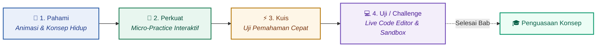

| Fase | Warna Tema | Fokus Pembelajaran | Interaksi Siswa |
|---|---|---|---|
| **1. Pahami** | 🔵 Sapphire (`#2B5EA7`) | Membangun intuisi awal dan analogi dunia nyata | Eksplorasi slide interaktif, penggeser nilai, dan animasi alur data |
| **2. Perkuat** | 🟢 Emerald (`#1E7E55`) | Mengunci pemahaman lewat latihan mikro | Pasangkan blok, prediksi nilai memori, susun logika |
| **3. Kuis** | 🟡 Amber (`#B7790C`) | Memverifikasi konsep sebelum menulis sintaks | Pilihan ganda berbobot, prediksi output terminal tanpa bantuan editor |
| **4. Uji** | 🟣 Violet (`#7048B6`) | Menerapkan kode nyata di editor CodeMirror | Menulis JavaScript, menjalankan runner sandbox, melewati test-cases |

---

## 📸 Galeri Antarmuka

### 1. Peta Petualangan Belajar
> Alur kurikulum bertahap dengan pelacak kemajuan visual, cincin progres per bab, dan streak belajar harian.

<p align="center">
  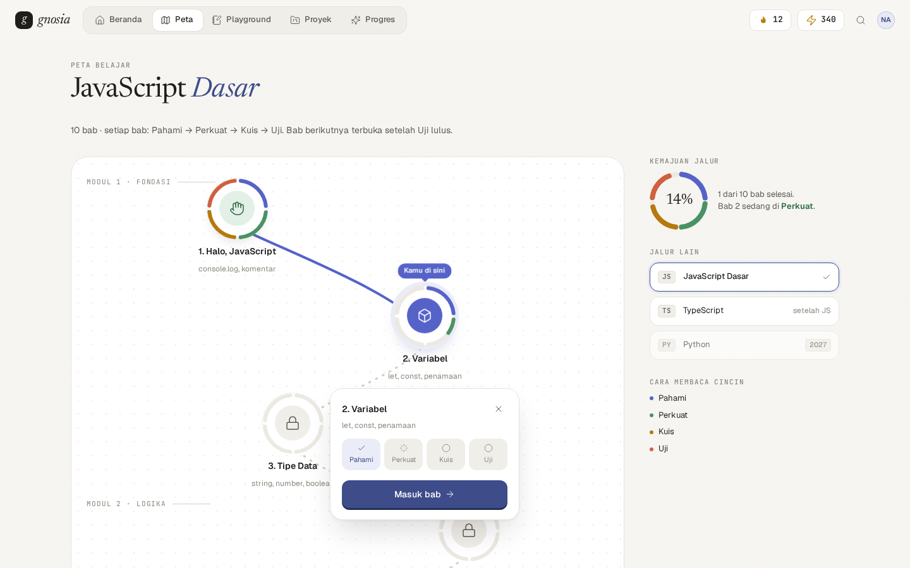
</p>

---

### 2. Fase Pahami & Perkuat
> Menjelaskan logika memori dan variabel melalui analogi interaktif, diikuti soal penguat konsep.

<p align="center">
  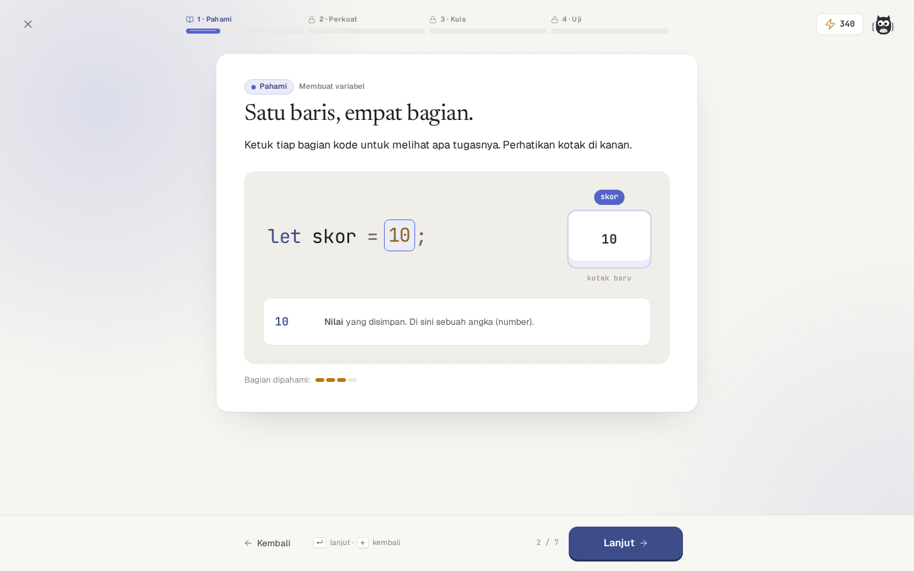
  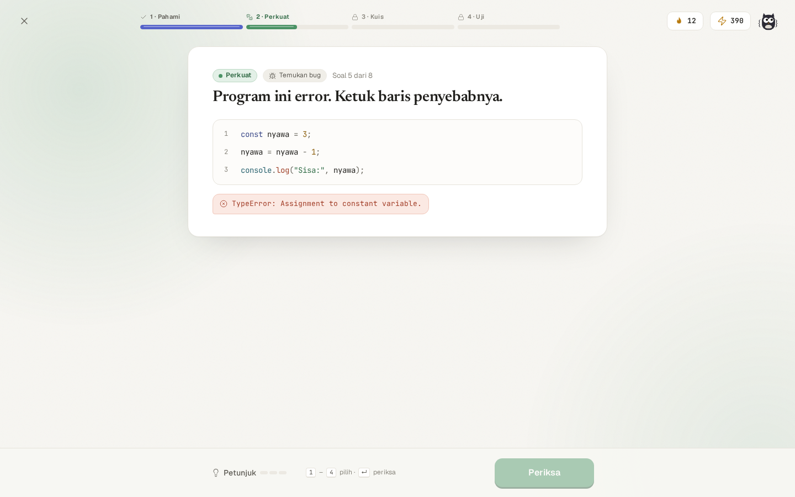
</p>

---

### 3. Fase Kuis & Tantangan Ngoding
> Uji logika cepat, dilanjutkan dengan editor kode CodeMirror 6 yang terhubung langsung ke sandbox execution.

<p align="center">
  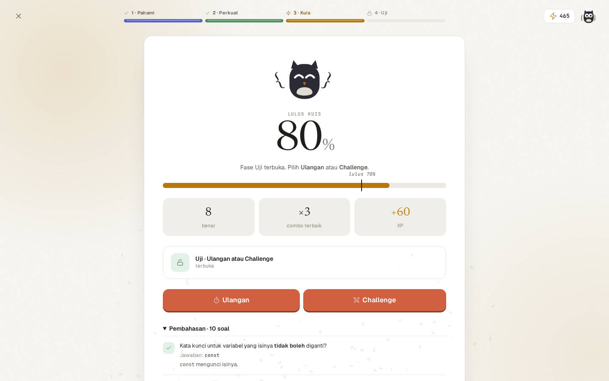
  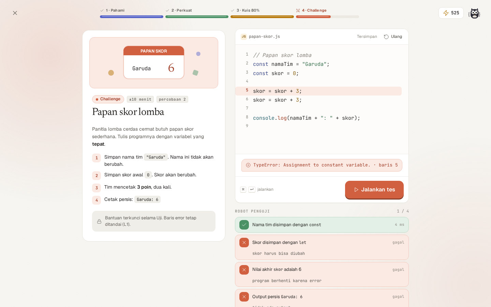
</p>

---

### 4. Cockpit Guru & Mentor
> Dashboard analitik pemantauan 32+ siswa: antrean review kode, sinyal siswa macet (gagal 4×, hint rush, stuck), dan progress kelas.

<p align="center">
  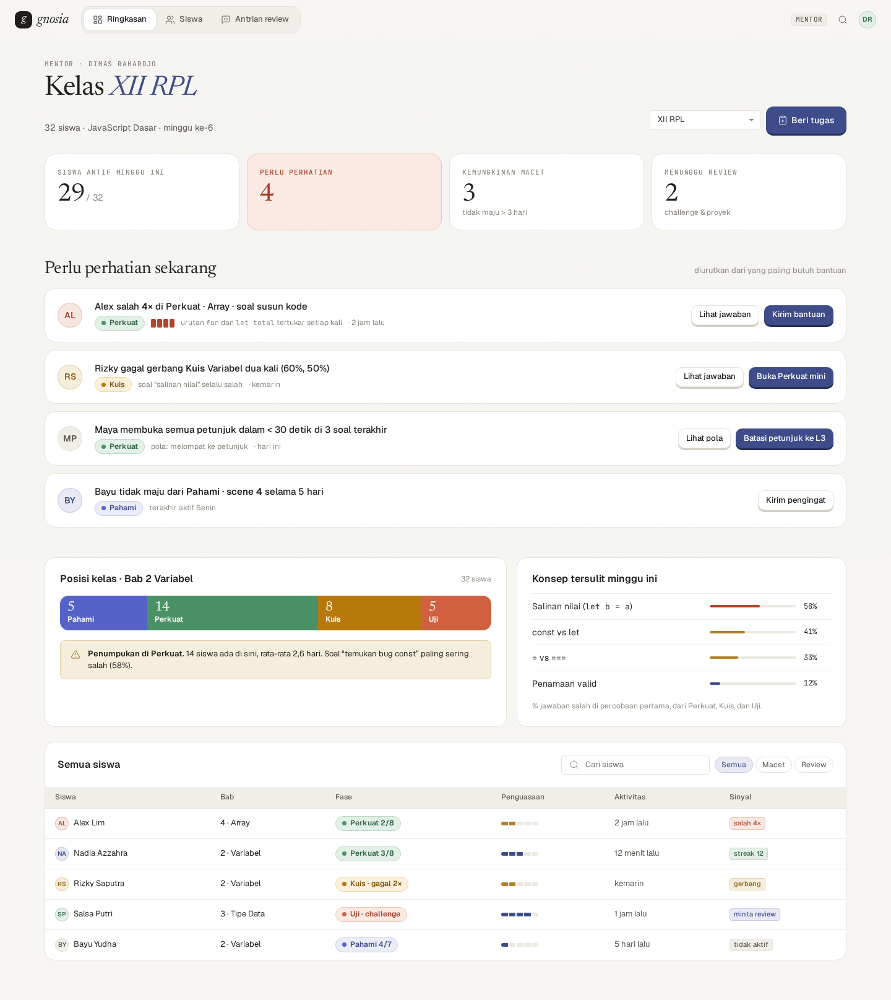
</p>

---

### 5. Cockpit Admin & Kurikulum Builder
> Manajemen silabus, penyunting bab & langkah belajar, flagging materi, serta konfigurasi test-case otomatis.

<p align="center">
  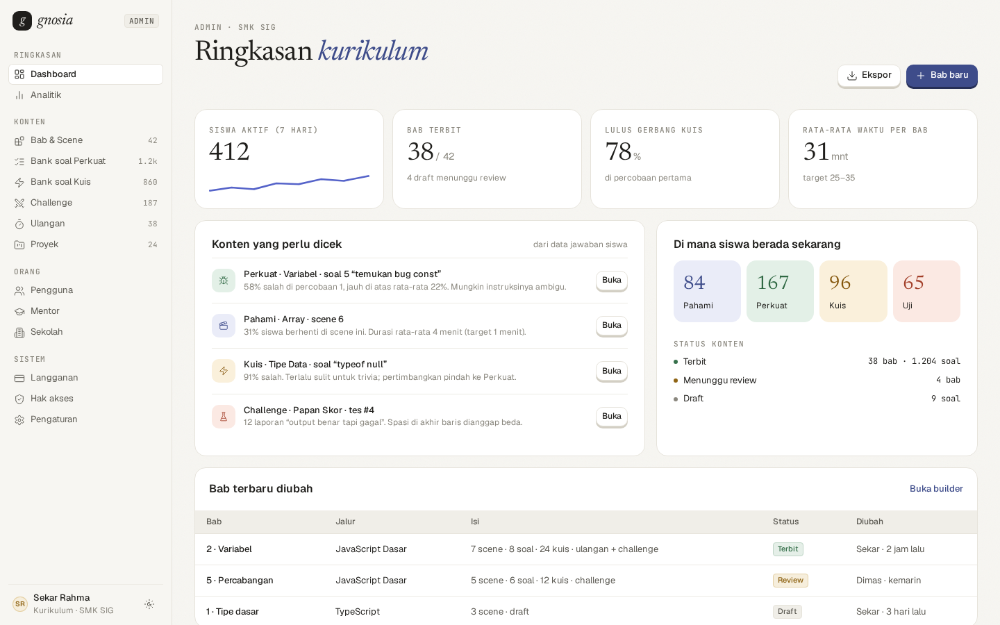
</p>

---

### 6. Playground Bebas
> Ruang eksperimen mandiri bagi siswa untuk mencoba ide kode JavaScript secara bebas didampingi Nosi.

<p align="center">
  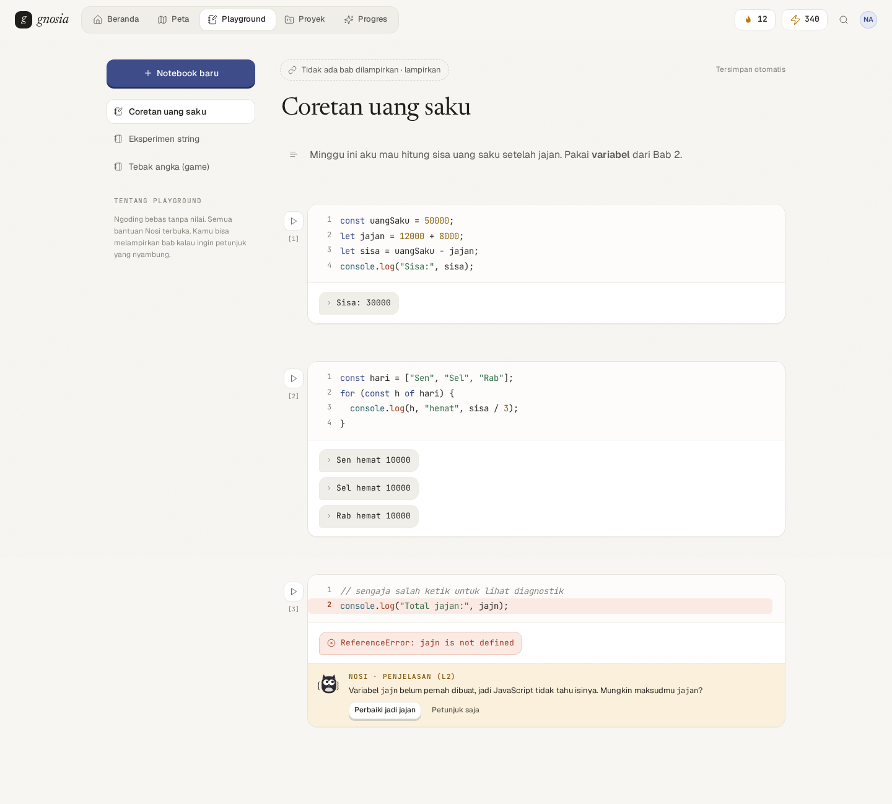
</p>

---

## 🎨 Sistem Desain: Warm Paper & Editorial Ink

GNOSIA mengadopsi estetika **Warm Editorial** yang nyaman dipandang berjam-jam:
- **Latar Kertas Alami (`--bg-paper`)**: `#F8F5EE` / `#F4EFE4`, mengurangi kelelahan mata dibanding warna putih silau.
- **Tinta Tipografi (`--ink`)**: `#1F1E1B` dengan kontras tinggi yang tajam.
- **Font Stack Berkualitas**:
  - Judul & Aksen: Font Serif klasik yang elegan.
  - Teks Antarmuka: System UI modern (`-apple-system`, `Inter`, `Segoe UI`).
  - Kode & Terminal: `JetBrains Mono` yang sangat mudah dibaca.
- **Dark Mode ("Tinta Malam")**: Palet slate gelap `#17161F` dengan kontras lembut.

<p align="center">
  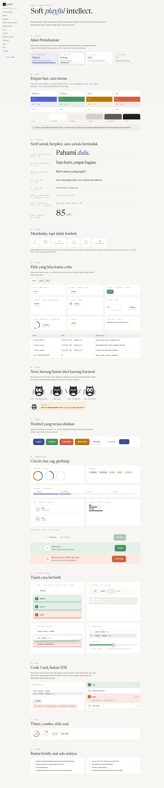
</p>

---

## ⚙️ Arsitektur & Teknologi

```
gnosia/
├── frontend/             # Antarmuka Pengguna (SPA)
│   ├── src/design/       # Komponen Sistem Desain, Ikon, Nosi SVG
│   ├── src/player/       # Engine Pembelajaran 4 Fase
│   ├── src/code/         # Integrasi CodeMirror 6 & syntax highlighting
│   ├── src/mentor/       # Dashboard & Cockpit Mentor
│   └── src/admin/        # Manajemen Kurikulum & Builder
├── backend/              # Web API & Server Aplikasi
│   ├── app/routers/      # Endpoint Auth, Learner, Mentor, Admin, Workspace
│   ├── app/services/     # Sinyal kesulitan, evaluator kode, kalkulator streak
│   ├── app/seed/         # Kurikulum bawaan (Bab 1: Halo, Bab 2: Variabel, dsb)
│   └── runner/           # Sandbox runner Node.js (node:vm aman)
├── design/               # Spesifikasi desain, token CSS/JSON, & tangkapan layar
│   ├── shots/            # High-res screenshots 1440px & mobile 390px
│   ├── mockups/          # Mockup murni HTML/CSS referensi
│   └── tokens.css        # Variabel CSS desain sistem
└── scripts/              # Otomasi deployment Docker, quick tunnel, & setup DB
```

| Bagian | Teknologi | Keterangan |
|---|---|---|
| **Frontend** | React 19, TypeScript, Vite | Komponen modern, rendering ultra cepat |
| **State & Data** | TanStack Query (React Query) | Sinkronisasi data server & cache otomatis |
| **Code Editor** | CodeMirror 6 | Editor kelas profesional dengan autocomplete JavaScript |
| **Backend API** | FastAPI, Python 3.12+ | Asynchronous REST API berkecepatan tinggi |
| **Database** | PostgreSQL 15+ / SQLite | Relational ORM via SQLAlchemy 2.0 |
| **Code Sandbox** | Node.js (`node:vm`) | Isolasi eksekusi kode siswa dengan limit memori & timeout |
| **DevOps** | Docker, Docker Compose, Cloudflare | Siap kontainer & tunnel instan tanpa IP publik |

---

## 🚀 Menjalankan Aplikasi

### Opsi A: Docker + Cloudflare Tunnel (Satu Perintah, Otomatis)

Cara paling praktis untuk menguji coba secara lokal maupun membagikan URL publik sementara (bisa diakses langsung dari HP atau teman tanpa port forwarding):

**Linux / macOS / WSL:**
```bash
chmod +x scripts/tunnel.sh
./scripts/tunnel.sh
```

**Windows (PowerShell):**
```powershell
powershell -ExecutionPolicy Bypass -File .\scripts\tunnel.ps1
```

Skrip akan secara otomatis:
1. Menyiapkan kredensial acak yang aman di `.env`.
2. Menyalakan database PostgreSQL dan aplikasi backend/frontend di Docker.
3. Menghubungkan ke Cloudflare Quick Tunnel dan mencetak URL aktif:
   `https://<nama-acak>.trycloudflare.com`

*Perintah kontrol tambahan:*
- Cek URL aktif: `./scripts/tunnel.sh url`
- Cek log kontainer: `./scripts/tunnel.sh logs`
- Berhenti: `./scripts/tunnel.sh stop`
- Reset data ke kondisi awal: `./scripts/tunnel.sh reset`

---

### Opsi B: Development Lokal (FastAPI + Vite)

**Kebutuhan Sistem:** Python 3.12+, Node.js 20+, PostgreSQL 15+ (atau SQLite).

1. **Salin environment backend:**
   ```bash
   cp backend/.env.example backend/.env
   ```
2. **Jalankan script dev otomatis (Windows):**
   ```powershell
   .\dev.ps1 -Setup
   .\dev.ps1
   ```
   *Atau secara manual (macOS/Linux):*
   ```bash
   # Terminal 1: Backend
   cd backend
   python3 -m venv .venv
   source .venv/bin/activate
   pip install -r requirements.txt
   python3 -m app.seed
   uvicorn app.main:app --reload --port 8000

   # Terminal 2: Frontend
   cd frontend
   npm install
   npm run dev
   ```
3. **Buka browser:**
   - Aplikasi: `http://localhost:5173`
   - Dokumentasi Swagger API: `http://localhost:8000/docs`

---

### Opsi C: Deploy Publik di Render (Gratis, Link Tetap)

1. Buat database PostgreSQL gratis di [Neon](https://neon.tech) atau [Supabase](https://supabase.com), lalu salin connection string-nya.
2. Di [Render](https://render.com): **New + → Blueprint** → pilih repo ini (konfigurasi ada di [`render.yaml`](render.yaml)).
3. Isi `GNOSIA_DATABASE_URL` dengan connection string dari langkah 1, lalu **Apply**.
4. Tunggu build selesai. Aplikasi hidup di `https://gnosia.onrender.com` (atau nama yang diberikan Render). Password akun demo ada di Environment → `GNOSIA_DEMO_PASSWORD`.

> Paket gratis Render tidur setelah 15 menit tanpa akses, jadi buka pertama setelah idle butuh ~1 menit.

## 👥 Akun Demo Siap Pakai

Semua akun demo di lingkungan lokal menggunakan kata sandi: `gnosia123` *(pada Docker tunnel, kata sandi acak dicetak di terminal)*.

| Peran | Akun Email | Data & Keadaan Siswa |
|---|---|---|
| **Siswa (Juara)** | `nadia@smksig.sch.id` | Bab 1 selesai, Bab 2 berjalan di Perkuat 3/8, streak 12 hari |
| **Siswa (Proyek)** | `salsa@smksig.sch.id` | Bab 2 selesai, proyek Kalkulator Uang Saku menunggu review |
| **Siswa (Macet)** | `alex@smksig.sch.id` | Memerlukan bimbingan: salah 4× berturut-turut pada gerbang logika |
| **Mentor / Guru** | `dimas@smksig.sch.id` | Mengampu kelas XII RPL (32 siswa), antrean review aktif |
| **Administrator** | `sekar@smksig.sch.id` | Akses kurikulum builder, flag konten, manajemen pengguna |

> Ingin mencoba pendaftaran dari nol? Kunjungi halaman `/daftar` untuk merasakan alur onboarding awal.

---

## 🧪 Menjalankan Pengujian (Testing)

```bash
# Pengujian Backend (Pytest)
cd backend
python -m pytest -q

# Validasi Tipe Frontend (TypeScript)
cd frontend
npm run typecheck
```

---

## 📁 Struktur Repositori

```
├── .github/              # Alur CI/CD GitHub Actions
├── backend/              # Server FastAPI, seed data, & sandbox runner
├── design/               # Design token, spesifikasi layar, & aset tangkapan layar
│   └── shots/            # Tangkapan layar antarmuka GNOSIA
├── docs/                 # Aset dokumentasi & vektor SVG maskot
│   └── assets/           # gnosia-banner.svg, nosi-mascot.svg
├── frontend/             # Kode sumber React 19 + TypeScript
├── scripts/              # Skrip tunnel Cloudflare & utilitas database
├── docker-compose.yml    # Konfigurasi containerization multi-service
├── Dockerfile            # Multi-stage Docker build frontend + backend
├── dev.ps1               # Runner praktis satu perintah dev
├── LICENSE               # Lisensi MIT
└── README.md             # Dokumentasi utama proyek
```

---

## 📄 Lisensi

Proyek ini didistribusikan di bawah lisensi **MIT License**. Silakan gunakan, pelajari, dan kembangkan untuk kemajuan pendidikan pemrograman di Indonesia.

<p align="center">
  Dibuat dengan ❤️ untuk pembelajaran kode yang menyenangkan · <strong>GNOSIA</strong>
</p>
